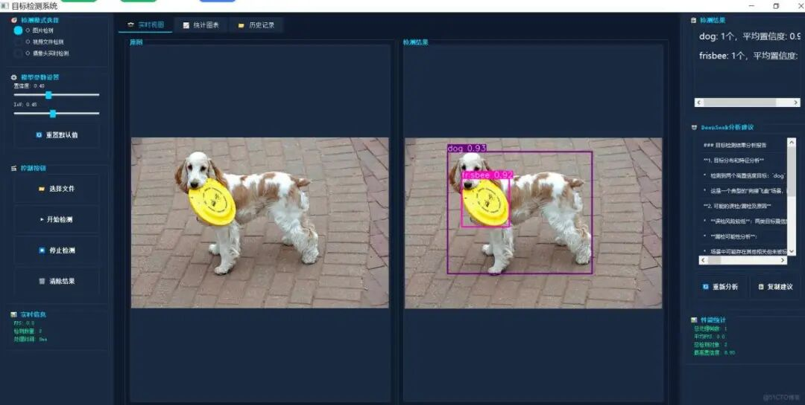

# Creating a High-End General Object Detection System Based on Yolo+PyQt5+DeepSeek, Supporting Yolov8, Yolov10, Yolov11, Yolov12, Yolov13, and Yolov26 Series Frameworks

YOLO11+ PyQt5 Object Detection System - A modern object detection system based on YOLO11 and PyQt5, supporting images, videos, and

### YOLO11+ PyQt5 Object Detection System

A modern target detection system based on YOLO11 and PyQt5, supporting real-time image, video, and camera detection, and integrating DeepSeek AI analysis capabilities.



#### Project Overview

This project is a fully functional object detection system, utilizing YOLOv11 as the core detection algorithm and PyQt5 as the graphical user interface framework. The system supports multiple detection modes, including image detection, video file detection, and real-time camera detection, and provides rich visualization capabilities and AI intelligent analysis capabilities.

#### Function Characteristics

##### Core Features

- **Multimodal Detection**

Supports image detection, video file detection, and real-time camera detection.

- **Real-time display**

- Left and right split screen displaying the original image and detection results for easy comparison and analysis.

- **Parameter Adjustment**

- Real-time adjustment of confidence threshold and IoU threshold.

- **Performance Statistics**

Real-time display of performance indicators such as FPS, detection count, and processing time.

- **History**

Record detection history, including time, mode, and path information.

- **Data Visualization**

Use pyecharts to generate statistical charts and intuitively display detection data.

##### AI Intelligent Analysis

- **DeepSeek integration**

Integrates DeepSeek API to provide intelligent detection results analysis.

- **Professional Suggestions**

Based on the detection results, provide parameters optimization and improvement suggestions.

- **Default Analysis**

When the API is unavailable, provide local analysis results.

#### Interface Features

- **Modern UI**

- Dark tech style, with a beautiful and elegant interface.

- **Responsive Design**

- The interface layout is reasonable, and the operation is convenient.

- **Multi-tab**

Real-time view, statistical charts, and historical records displayed in paginated format.

#### Environmental Requirements

##### Operating System

-

Windows 10/11

-

Linux (Ubuntu 18.04+)

-

macOS 10.14+

# Python version

-

Python 3.8 or higher

# Hardware Requirements

-

CPU: processors supporting AVX instruction set

-

Memory: Recommended to have more than 8GB.

-

Graphics card: NVIDIA graphics card with CUDA support (optional, for acceleration)

-

Disk Space: at least 2GB of available space

#### Installation and Configuration

##### 1. Clone or Download the Project

```
git clone code
cd yolo11-pyqt5
```

##### 2. Create a virtual environment (recommended)

```
# Create a virtual environment using venv
python -m venv venv
# Activating a Virtual Environment
# Windows:
venv\Scripts\activate
# Linux/macOS:
source venv/bin/activate
```

##### 3. Install Dependencies

```
pip install -r requirements.txt
```

Dependency package list:

-

PyQt5==5.15.10 - Graphical User Interface framework

-

opencv-python==4.8.1.78 - Image Processing Library

-

ultralytics==8.3.248 - YOLO model library

-

requests==2.31.0 - HTTP request library

-

numpy==1.24.4 - Numerical Computation Library

-

pyecharts==2.0.3 - Data Visualization Library

##### 4. Download the YOLOv11 model

When the program is first run, it will automatically download the `yolo11n.pt` model file. If the download fails, you can manually download it:

```
# Download using the ultralytics command
yolo detect predict model=yolo11n.pt
# or download it from the official website and place it in the project directory.
# Download Link: https://github.com/ultralytics/assets/releases
```

#### Usage Method

##### Launch Program

```
python main.py
```

#### Basic Operations

### 1. Choose the detection mode

- **Image detection**

Select a single image for object detection.

- **Video file detection**

Select video files for frame-by-frame detection.

- **Real-time Camera Detection**

- Camera for real-time detection

### 2. Adjust parameters

- **Confidence threshold**

Control the confidence of detection, the higher the value, the stricter the detection.

- **IoU threshold**

Controlling the Overlap Threshold for Non-Maximum Value Suppression

- **Reset default values**

- Reset default parameter settings with one click

### 3. Control Testing

- **Select Files**

Select the image or video file to be detected.

- **Start Detection**

: Start the detection process

- **Stop detection**

Stop the ongoing detection.

- **Clear results**

- Clear all detection results and statistical information

### 4. Review Results

- **Real-time view**

- Left and right split screen displaying the original image and detection results.

- **Statistical Charts**

: View statistical information of detection mode

- **History**

View the detection history, including time, mode, and path.

### 5. AI analysis

- **Re-analyze**

Re-invoke DeepSeek API to analyze the current detection results.

- **Copy suggestion**

Copy the analysis suggestions to the clipboard.

#### Algorithm Principles

# YOLO11 algorithm

YOLO11 (You Only Look Once) is a real-time object detection algorithm with the following characteristics:

###### Core idea

- **Single-stage detection**

Treat target detection as a regression problem, directly predicting bounding boxes and class probabilities from the image.

- **End-to-end training**

The entire network is optimized end-to-end during training.

- **Real-time performance**

- Fast detection speed, suitable for real-time application scenarios

### Network Structure

- **Backbone**

Feature Extraction Network, using CSPDarknet to extract image features.

- **Neck**

Feature fusion network, using PANet for multi-scale feature fusion.

- **Head**

Detector head, predicting bounding boxes, target confidence and class probabilities

###### Testing Process

1. **Image Preprocessing**

Adjust image size, normalize pixel values

1. **Feature Extraction**

Extracting image features through a Backbone network.

1. **Feature fusion**

Through Neck network to fuse multi-scale features

1. **Predicted output**

Predicting detection results through Head network

1. **Post-processing**

- Apply NMS (Non-Maximum Suppression) to remove duplicate detections.

### Key Technologies

- **Anchor-Free**

: Predict the target bounding box without using predefined anchor boxes.

- **Multi-scale detection**

Detection on feature maps of different scales to enhance the detection capability for small targets.

- **Loss function**

- Utilize CIoU loss function to enhance positioning accuracy

- **Data Augmentation**

- Utilize data augmentation techniques such as Mosaic and MixUp to enhance the generalization capability of the model.

##### Parameter Descriptions

### Confidence Threshold

- **Definition**

Confidence threshold for object detection

- **Function**

Filtering detection results with confidence below the threshold.

- **Suggested value**

 : 0.4-0.6

- **Impact**

 : 

-

Higher values: stricter detection, may miss some items, but the rate of false positives is low.

-

The lower the value: The test is more lenient, may cause false positives, but has a high recall rate.

###### IoU threshold (Intersection over Union)

- **Definition**

Non-maximum suppression overlap threshold

- **Function**

Control the strictness of NMS algorithm for removing duplicate detections.

- **Suggested value**

0.4-0.5 (dense scene), 0.6-0.7 (sparse scene)

- **Impact**

 : 

-

Higher value: retains more overlapping detection boxes, which may result in duplicate detection.

-

Lower values: More stringent removal of overlapping detection boxes, may miss

#### DeepSeek API Configuration

##### 1. Request DeepSeek API Key

### Register an Account

1.

Visit DeepSeek official website: https://www.deepseek.com/

1.

Click the "Register" button, fill in registration information.

1.

Complete email verification

###### GET API Key

1.

Log in to DeepSeek account

1.

Enter the "API Key" page.

1.

Click the "Create API Key" button

1.

Copy the generated API key (format: sk-xxxxxxxxxxxx)

###### Recharge (optional)

-

DeepSeek API usually provides free quotas.

-

For more call-backs, you can make a recharge on the "Recharge" page.

-

View Pricing Information: https://www.deepseek.com/pricing

# 2. Change API Key

Open the `main.py` file, find the DeepSeekAPI initialization code around line 404:

```
# Initialize DeepSeek API (using the example API key, replace it with actual)
self.deepseek_api = DeepSeekAPI(api_key='sk-d2eb5dc896884f62853d9d1ba89f6065')
```

Replace the example API key with your own API key:

```
self.deepseek_api = DeepSeekAPI(api_key='YoursAPIKey')
```

##### 3. API Call Instructions

###### Invoke Restrictions

- **Rate Limiting**

Rate limits vary based on account levels.

- **Token Limitation**

: Each request has a maximum token limit.

- **Timeout settings**

Default timeout time is 30 seconds.

###### Error Handling

- **Network Error**

Check your network connection to ensure access to the DeepSeek API.

- **Certification Failure**

Check if the API key is correct.

- **Insufficient quota**

Check account balance, and recharge if necessary.

- **Timeout Error**

Check for network latency or increase timeout time.

### Default Analysis

When an API call fails, the system will use a default analysis method to provide basic results analysis. The default analysis includes:

-

Summary of test results

-

Parameter optimization suggestions

-

Measures to improve detection accuracy

-

Input image quality assessment

-

Practical value analysis

#### Project Structure

```
yolo11-pyqt5/
├── main.py  # Main program file
├── requirements.txt  # Dependency package list
├── yolo11n.pt  # YOLO11 model file
└── README.md  # Project Description Document
```

#### Main Class Descriptions

###### DeepSeekAPI

-

Function: Invoke DeepSeek API to analyze the results.

-

Main method:

- `analyze_detection()`

Analysis of detection results

- `get_default_analysis()`

: Fetch default analysis results

###### DeepSeekAnalyzerThread

-

Function: DeepSeek analysis thread, avoid blocking UI.

-

Signal:

- `analysis_complete`

Analyze completion signal

- `analysis_error`

Analyze error signals

###### DetectionThread

-

Function: Detect thread, perform target detection in the background.

-

Main method:

- `detect_image()`

Detecting images

- `detect_video()`

Detection video

- `detect_camera()`

Detection Camera

- `stop()`

Stop detection

-

Signal:

- `detection_complete`

: Detection completion signal

- `detection_progress`

Detection progress signal

- `detection_error`

Detecting error signals

###### MainWindow

-

Function: Main window class, manages the entire UI interface.

-

Main method:

- `setup_ui()`

: Setting UI interface

- `init_stylesheet()`

Initialize the stylesheet

- `select_file()`

Select file

- `start_detection()`

Starting the detection

- `stop_detection()`

Stop detection

- `update_display()`

Update display area

- `update_detection_results()`

Update the detection results

- `update_performance_stats()`

Update performance statistics

- `update_history_table()`

Update history

- `update_stats_chart()`

Update statistical charts

#### Common Issues

##### 1. Program Startup Failure

**Problem**: Errors occur when running `python main.py`

**Solution**:

-

Check if the Python version is 3.8 or higher

-

Ensure all dependencies are installed: `pip install -r requirements.txt`

-

Check if there are permission issues and try running with administrator privileges.

# 2. Model file download failure

**Issue**: The model file `yolo11n.pt` cannot be downloaded during the first run.

**Solution**:

-

Check your network connection to ensure access to GitHub.

-

Manually download the model files: https://github.com/ultralytics/assets/releases

-

Place the downloaded model files into the project directory.

##### 3. Video detection is not responding

**Issue**: After selecting a video file and clicking "Start Detection," there is no response.

**Solution**:

-

Check if the video file formats are supported (.mp4, .avi, .mov)

-

Check if the video file is corrupted.

-

Check console output to understand specific error messages.

-

Try using other video files to test.

# 4. Camera cannot be opened

**Issue**: Camera Real-Time Detection Cannot Open the Camera

**Solution**:

-

Check if the camera is occupied by other programs.

-

Check if the camera driver is properly installed.

-

Attempt to change the camera ID (default is 0)

-

Check system permission settings

##### 5. DeepSeek API Call Failure

**Issue**: AI analysis feature is not working properly.

**Solution**:

-

Check if the API key is correct.

-

Check your network connection to ensure access to the DeepSeek API.

-

Check if the account balance is sufficient.

-

Check console output to understand specific error messages.

-

The system will automatically use the default analysis, which will not affect the basic functionality.

##### 6. The test results are incorrect in color

**Issue**: Incorrect color display of the right-side detection result image

**Solution**:

-

This issue has been resolved in the latest version.

-

Ensure that the code is using the latest version.

-

If the issue persists, please check the color conversion logic in the `update_display` method.

##### 7. Displaying anomalies on the interface

**Issue**: The interface layout is chaotic or the style is incorrect.

**Solution**:

-

Ensure PyQt5 version is correct: `pip install PyQt5==5.15.10`

-

Check the system DPI settings and try adjusting the scaling ratio.

-

Try to reinstall PyQt5: `pip uninstall PyQt5 && pip install PyQt5==5.15.10`

##### 8. Performance Issues

**Problem**: Slow detection speed or program freezes.

**Solution**:

-

Use GPU acceleration: Install PyTorch with CUDA version.

-

Reduce the resolution of input image

-

Use smaller models (e.g., yolo11n.pt)

-

Adjust the confidence and IoU thresholds to reduce the number of detection boxes.

-

Close other programs that occupy system resources.

#### Performance Optimization Suggestions

##### 1. Model selection

- **yolo11n.pt**
- **yolo11s.pt**
- **yolo11m.pt**
- **yolo11l.pt**
- **yolo11x.pt**

##### 2. GPU Acceleration

```
# Installing PyTorch with CUDA version
pip install torch torchvision torchaudio --index-url https://download.pytorch.org/whl/cu118
```

##### 3. Parameter Tuning

-

Adjust the confidence threshold according to the scenario

-

Adjust IoU threshold based on target density

-

Use the appropriate input image resolution.

##### 4. Batch Processing

-

For a large number of images, consider batch processing mode.

-

Use multithreading or asynchronous processing to improve efficiency.

#### Update Log

##### v1.0.0 (2026-02-10)

-

Initial version release

-

Supports image, video, and camera detection.

-

Integrate DeepSeek AI analysis feature

-

Implementing historical records and statistical charts

-

Fix color display issues

-

Optimize the interface layout and style


## Payment

Here is a pay link on Stripe ( https://buy.stripe.com/3cs8yP7sY87d0vu9AB ). Please contact me lonlonago@foxmail.com after funding $89, and I will send you a complete data files , thank you!


